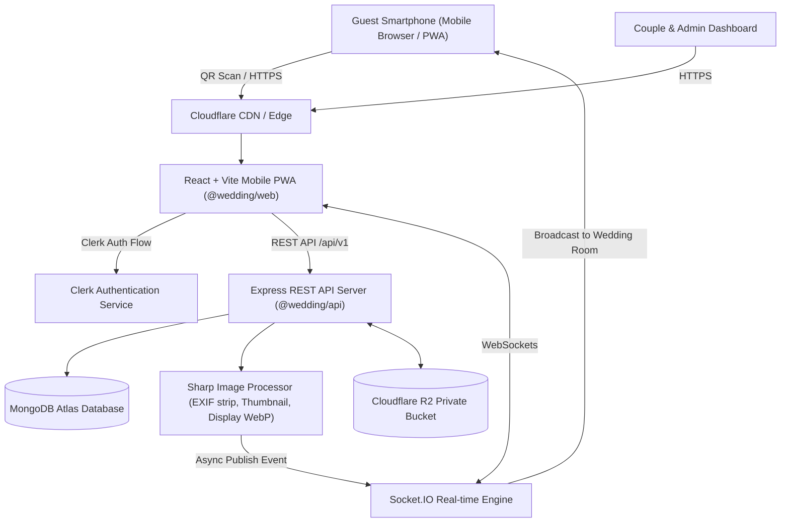

# Royal Wedding Platform — Architecture Overview

## 1. System Vision
The Royal Wedding Photo Sharing Platform is a multi-tenant, mobile-first web application designed for the high-volume, real-time photo sharing needs of Indian weddings.

## 2. Architecture Diagram

## 3. Key Tenets
1. **Multi-Tenancy & Data Isolation**:
   - Every wedding is completely isolated. Data queries always enforce `weddingId` filtering on backend middleware.
   - Storage objects in Cloudflare R2 are namespaced: `weddings/{weddingId}/photos/{photoId}/{variant}.webp`.
   - Socket.IO rooms are segmented per wedding: `room:wedding:{weddingId}`.

2. **Automated Validation & Immediate Publishing**:
   - Zero manual approval queue for standard uploads.
   - Real-time MIME type validation, magic bytes signature verification, and image dimension checking.
   - GPS and sensitive EXIF metadata stripped via Sharp before saving.
   - Thumbnails (400px width) and display versions (1600px width) generated on the fly.
   - Sockets immediately broadcast newly published photos to all connected guests in that wedding room.

3. **Privacy & Security**:
   - No direct photo download buttons or bulk guest ZIP exports.
   - No watermarking or awkward screenshot blockers.
   - Role-Based Access Control (RBAC): Owner, Admin, Event Manager, Guest.
   - Invitations use cryptographically secure random tokens; token hashes (`sha256`) are stored in the database.
